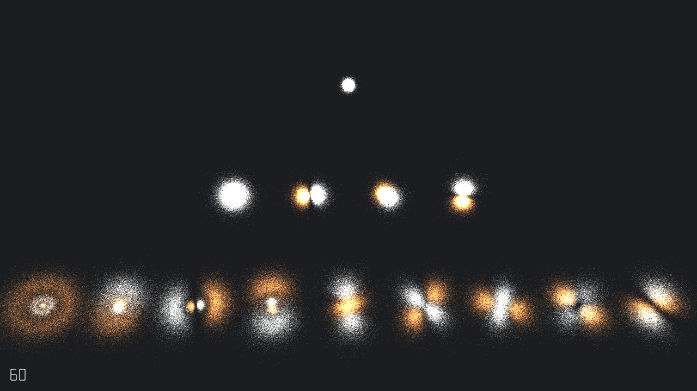
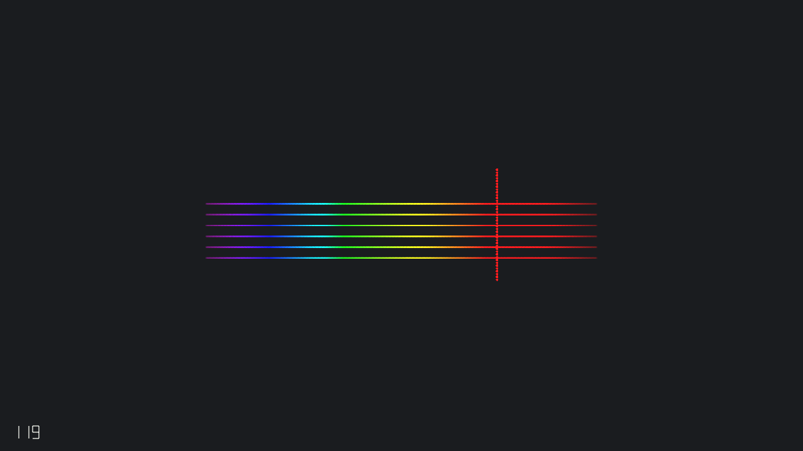

# Hydrogen atom in C++

A hydrogen atom simulated from scratch in C++. The code only gets one rule, Schrödinger's equation, and two charges. It is never given the answer: not the energy, not the shapes, not the color of the light.

This is the code from the Think in Lines video **"I Simulated a Hydrogen Atom in C++"**.



## What it finds

| | My code | Measured |
|---|---|---|
| Energy to take the electron away | 13.60 eV | 13.598 eV ([NIST](https://physics.nist.gov/PhysRefData/Handbook/Tables/hydrogentable1.htm)) |
| Red line of a hydrogen lamp (3 → 2) | 655.5 nm | 656.3 nm ([NIST](https://physics.nist.gov/PhysRefData/Handbook/Tables/hydrogentable2.htm)) |

The textbook orbitals 1s, 2s, 2p, 3s, 3p and 3d appear by themselves.



## Follow the video, one commit at a time

The history has one commit for each step of the video. Check out any of them to run that step.

| Step | What it adds |
|---|---|
| 1 | The window: zoom, mouse rotation, three color themes, a hand-drawn frame counter |
| 2 | The electron as a little planet: a perfect orbit at 52.9 pm |
| 3 | The light lost on every turn: the electron falls in after 15.6 ps |
| 4 | The electron becomes a wave on a 3D grid (with the divide-by-zero bug from the video) |
| 5 | The grid moved by half a point: the first cloud, −12.89 eV |
| 6 | Finer grids on all cores |
| 7 | Energy against spacing squared, followed to zero: −13.60 eV |
| 8 | A second state gives the same sphere again |
| 9 | 14 states at once: groups of 1, 4 and 9 |
| 10 | Mirrors and turning: the textbook shapes, with their names |
| 11 | From energy to light: 647.6 nm on one grid |
| 12 | Two grids and zero spacing: 655.5 nm |

```
git log --oneline          # the 12 steps
git checkout <commit>      # go to a step
git checkout main          # back to the end
```

`output.txt` in each commit is the real output of that step.

## Build and run

You need a C++17 compiler with OpenMP, SDL2 and OpenGL. On Debian or Ubuntu:

```
sudo apt install g++ libsdl2-dev libgl-dev pkg-config
g++ -O3 -march=native -fopenmp main.cpp -o atom $(pkg-config --cflags --libs sdl2 gl)
./atom
```

Steps 9 to 12 compute 14 states on about 900,000 grid points: they take a few minutes on eight cores.

## License

MIT. See [LICENSE](LICENSE).
